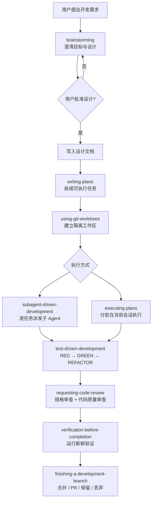

# Superpowers 使用指南

> **abstract** 一句话说明
> [Superpowers](https://github.com/obra/superpowers) 不是一个新的 Coding Agent，而是一套安装在 Claude Code、Codex、Cursor 等 Agent 上的**软件开发方法论与可组合 Skills**。它把一次开发任务约束为“需求澄清 → 设计 → 计划 → 隔离开发 → TDD 实现 → Code Review → 验证 → 合并”的工程闭环。

> **info** 本文基线
> 本文依据仓库 `v6.1.1`、提交 `d884ae0`（2026-07-02）整理。项目迭代较快，安装命令以官方 README 为准。

## 目录

- [#一、Superpowers 是什么](#一、Superpowers 是什么)
- [#二、它解决什么问题](#二、它解决什么问题)
- [#三、核心工作流](#三、核心工作流)
- [#四、内置 Skills 详解](#四、内置 Skills 详解)
- [#五、安装方法](#五、安装方法)
- [#六、如何使用](#六、如何使用)
- [#七、典型使用场景](#七、典型使用场景)
- [#八、关键规则与设计哲学](#八、关键规则与设计哲学)
- [#九、常见问题与注意事项](#九、常见问题与注意事项)
- [#十、快速参考](#十、快速参考)
- [#十一、相关链接](#十一、相关链接)

## 一、Superpowers 是什么

普通 Coding Agent 往往会在收到需求后立刻写代码。Superpowers 在 Agent 上增加了一套强制性的工程流程：Agent 必须先识别相关 Skill，按照 Skill 的步骤工作，并在关键阶段等待用户确认或提供验证证据。

它由三部分组成：

1. **Skills Library**：一组 Markdown 形式的流程规范，覆盖设计、计划、TDD、调试、Review、Git worktree 和收尾。
2. **启动指令与 Hooks**：会话开始时注入 `using-superpowers`，要求 Agent 在回复甚至提问之前先判断是否存在适用 Skill。
3. **平台适配层**：让同一套方法可以运行在 Claude Code、Codex、Cursor、OpenCode、Kimi Code、Pi 等不同 Agent Harness 中。

它的价值不在于增加模型能力，而在于**限制模型随意发挥的空间**：把“凭感觉写代码”变成有设计、有测试、有审查、有证据的过程。

> **note** Skill 是什么
> Skill 是 Agent 按需加载的流程说明。它通常包含触发条件、不可跳过的规则、步骤、检查清单和参考资料。Superpowers 的 Skills 是**工作流约束**，不只是供人阅读的教程。

## 二、它解决什么问题

Superpowers 主要针对 Coding Agent 的这些常见失误：

- 未澄清目标就开始实现，最终“代码正确但需求错误”。
- 没有比较方案，把最先想到的方法当成最佳方案。
- 一次修改过大，缺少可审查、可回滚的中间节点。
- 先写实现再补测试，测试只能证明代码按自身逻辑运行。
- 遇到 Bug 时连续猜测和打补丁，没有定位根因。
- 声称“已经修复”或“测试通过”，却没有运行完整验证命令。
- 多 Agent 并行时任务耦合、修改冲突，或子 Agent 偏离计划。
- 完成代码后不知道该合并、提 PR、保留分支还是清理 worktree。

因此它更适合以下任务：

- 新功能开发；
- 有明确验收标准的 Bug 修复；
- 中大型重构；
- 可以拆成多个独立任务的实现计划；
- 希望 Agent 长时间自主执行，但仍保持可控性的项目。

对于只改错别字、解释代码、浏览文件等只读或极小任务，这套完整流程可能显得偏重；但实际是否触发由 Skill 的描述和平台集成决定。

## 三、核心工作流



### 1. 需求与设计：`brainstorming`

Agent 先查看项目上下文，再一次问一个问题，弄清目标、约束与成功标准；随后给出 2～3 个方案及取舍，并分段展示设计供用户确认。未经用户批准，不应写实现代码。

通过后的设计默认保存到：

```text
docs/superpowers/specs/YYYY-MM-DD-<topic>-design.md
```

### 2. 实现计划：`writing-plans`

设计获批后，Agent 生成可以交给“不了解项目的工程师”执行的详细计划。计划需要给出：

- 精确文件路径；
- 每项任务的输入与输出接口；
- 实际代码，而不是 `TODO`；
- 测试命令与预期结果；
- 2～5 分钟粒度的操作步骤；
- 频繁、明确的提交节点。

默认路径：

```text
docs/superpowers/plans/YYYY-MM-DD-<feature-name>.md
```

### 3. 隔离工作区：`using-git-worktrees`

开始实现前使用原生 workspace 能力或 `git worktree` 建立隔离分支，避免污染当前工作目录；创建后安装依赖并运行基线测试，确认不是在原本就失败的环境上继续开发。

### 4. 执行计划：两种方式

| 方式 | 适合情况 | 特点 |
|---|---|---|
| `subagent-driven-development` | 当前会话内有多个相对独立的任务 | 每个任务启用新的实现 Agent；任务后先查规格符合度，再查代码质量 |
| `executing-plans` | 希望分批执行并由人定期检查 | Agent 先审阅计划，再按批次执行；每批完成后汇报并等待反馈 |

### 5. 实现纪律：`test-driven-development`

每个行为都遵循严格的 RED–GREEN–REFACTOR：

1. 写一个失败的测试；
2. 运行并确认它因预期原因失败；
3. 编写使其通过的最小实现；
4. 运行并确认测试通过；
5. 在保持全绿的前提下重构。

如果代码先于测试写出，Skill 要求删除这段代码并从失败测试重新开始。其目的不是追求覆盖率数字，而是证明测试能够捕获缺失行为。

### 6. Review、验证与收尾

- `requesting-code-review`：对照设计和计划审查，按严重程度报告问题；关键问题会阻止继续推进。
- `receiving-code-review`：先理解和验证反馈，再修改；不要求对 Review 意见盲目赞同。
- `verification-before-completion`：声明完成前，必须当场运行能够证明声明的完整命令并读取结果。
- `finishing-a-development-branch`：测试通过后，向用户提供合并、创建 PR、保留分支或丢弃修改等明确选项，并根据选择清理 worktree。

## 四、内置 Skills 详解

仓库当前包含 13 个主要 Skills。

### 设计与执行

| Skill | 触发时机 | 核心作用 |
|---|---|---|
| `using-superpowers` | 每次对话开始 | 强制先检查适用 Skill；只要有合理可能适用，就先加载再行动 |
| `brainstorming` | 创建功能、组件或改变行为之前 | 从模糊想法形成经过用户批准的设计与规格 |
| `writing-plans` | 已有需求或设计、准备进行多步实现时 | 把设计拆成精确、可测试、可交接的小任务 |
| `executing-plans` | 在独立会话执行既有计划时 | 分批实施，并在批次之间设置人工检查点 |
| `subagent-driven-development` | 当前会话执行多个独立计划任务时 | 每项任务使用全新子 Agent，并进行两阶段 Review |
| `dispatching-parallel-agents` | 存在两个以上互不依赖的问题时 | 并发调查或实现独立工作，最后整合结果 |

### 质量与调试

| Skill | 触发时机 | 核心作用 |
|---|---|---|
| `test-driven-development` | 实现功能或修复 Bug 之前 | 强制先看到测试失败，再写最小实现并重构 |
| `systematic-debugging` | 出现 Bug、测试失败或意外行为时 | 经过复现、证据收集、根因假设与最小验证后才提出修复 |
| `verification-before-completion` | 准备声称完成、修复或测试通过时 | 用本轮新运行的命令证明结论，禁止以推测代替证据 |
| `requesting-code-review` | 完成任务、重要功能或准备合并时 | 对照需求查缺失，并检查实现质量 |
| `receiving-code-review` | 收到 Review 反馈时 | 技术性地验证意见，澄清不明确之处，再逐项实现 |

### Git 与扩展

| Skill | 触发时机 | 核心作用 |
|---|---|---|
| `using-git-worktrees` | 功能开发需要隔离，或开始执行计划时 | 安全选择目录、建立 worktree、检查忽略规则并验证基线 |
| `finishing-a-development-branch` | 实现完成且测试通过时 | 规范完成分支的集成决策与清理流程 |
| `writing-skills` | 创建、修改或验证 Skill 时 | 把 TDD 用于流程文档：先构造压力测试，再编写 Skill 关闭漏洞 |

> **tip** 为什么表中看起来是 14 项？
> 仓库的主要 Skill 目录实际包含 14 个：README 的分类说明常将 `using-superpowers` 作为启动元 Skill 单独看待，因此有些介绍会称其为 13 个工作 Skills。以仓库目录为准。

## 五、安装方法

Superpowers 必须针对每个 Coding Agent 分别安装。即使已经在 Claude Code 中安装，也不会自动出现在 Codex 或 OpenCode 中。

### Codex App

1. 打开 Codex 左侧边栏的 **Plugins**。
2. 在 **Coding** 分类中找到 **Superpowers**。
3. 点击 `+`，按界面提示完成安装。

### Codex CLI

```text
/plugins
```

搜索 `superpowers`，选择 **Install Plugin**。

### Claude Code

使用官方 Marketplace：

```text
/plugin install superpowers@claude-plugins-official
```

也可以使用项目自己的 Marketplace：

```text
/plugin marketplace add obra/superpowers-marketplace
/plugin install superpowers@superpowers-marketplace
```

### Cursor

在 Cursor Agent Chat 中运行：

```text
/add-plugin superpowers
```

也可以在插件市场搜索 `superpowers`。

### Antigravity

```bash
agy plugin install https://github.com/obra/superpowers
```

重复执行同一命令即可更新。

### Factory Droid

```bash
droid plugin marketplace add https://github.com/obra/superpowers
droid plugin install superpowers@superpowers
```

### GitHub Copilot CLI

```bash
copilot plugin marketplace add obra/superpowers-marketplace
copilot plugin install superpowers@superpowers-marketplace
```

### Kimi Code

打开 `/plugins`，进入 `Marketplace → Superpowers` 安装；或：

```text
/plugins install https://github.com/obra/superpowers
```

### OpenCode

在 OpenCode 中要求 Agent 获取并执行官方安装说明：

```text
Fetch and follow instructions from https://raw.githubusercontent.com/obra/superpowers/refs/heads/main/.opencode/INSTALL.md
```

### Pi

```bash
pi install git:github.com/obra/superpowers
```

本地开发时可以临时加载仓库：

```bash
pi -e /path/to/superpowers
```

## 六、如何使用

### 1. 通常不必手动点名 Skill

安装后，Superpowers 会在会话开始时加载启动规则。用户可以像平时一样描述任务：

```text
为这个项目增加邮箱登录功能。需要支持验证码过期、频率限制和登录审计。
```

预期流程是：Agent 自动进入 `brainstorming`，查看项目、逐项澄清需求、比较方案，并在得到批准后才写设计文档和实施计划。

### 2. 需要时可以明确调用

自动触发不符合预期时，可以直接点名 Skill：

```text
请使用 brainstorming，先把需求和设计讨论清楚，不要开始实现。
```

```text
请使用 systematic-debugging 定位这个测试偶发失败的根因，暂时不要修复。
```

```text
使用 writing-plans，把已经批准的设计拆成可独立验证的任务。
```

```text
使用 subagent-driven-development 执行这份计划，每个任务完成后做规格和代码质量两轮审查。
```

### 3. 用户需要参与的关键节点

Superpowers 并不意味着完全无人值守。通常需要用户在以下节点作决定：

1. 回答 `brainstorming` 的需求问题；
2. 选择推荐方案或提出修改；
3. 批准书面设计；
4. 选择计划执行模式；
5. 查看执行批次或 Review 发现的问题；
6. 决定最终合并、PR、保留还是丢弃分支。

### 4. 推荐的任务开场模板

```text
我要实现：[目标]

背景：[为什么要做]
范围：[包含什么，不包含什么]
约束：[技术栈、兼容性、安全、性能等]
验收标准：[可以被测试或观察的结果]

请按 Superpowers 工作流推进，先做设计，不要直接实现。
```

信息不完整也没关系，`brainstorming` 本来就负责逐步补齐；但明确写出范围和验收标准能显著缩短问答过程。

## 七、典型使用场景

### 场景 A：开发新功能

```text
给现有 SaaS 增加组织级 API Key。Key 只能显示一次，需要轮换、撤销和审计日志。
请按 Superpowers 工作流，从 brainstorming 开始。
```

Agent 应先讨论数据模型、权限边界、密钥存储和迁移策略，再形成设计与计划，而不是直接创建数据库表。

### 场景 B：修复难复现 Bug

```text
订单测试在 CI 中偶发超时，本地很少出现。请使用 systematic-debugging：
先复现和定位根因，给出证据后再讨论修复，不要先增加 sleep 或重试。
```

该 Skill 会引导 Agent 区分症状与根因，追踪数据和控制流，并使用基于条件的等待取代随意延时。

### 场景 C：执行已存在的计划

```text
设计和计划已经通过评审。使用 subagent-driven-development 执行
docs/superpowers/plans/2026-07-11-api-key.md。
```

适合任务之间依赖明确、希望减少主 Agent 上下文污染的情况。

### 场景 D：多个独立失败

```text
当前有三个互不相关的失败：前端快照、支付 Webhook 和搜索索引。
使用 dispatching-parallel-agents 分别调查，汇总根因后再决定修复顺序。
```

只有在任务之间没有共享状态、不会改同一批文件、也不存在顺序依赖时，才适合并行。

## 八、关键规则与设计哲学

### Evidence over claims

“看起来没问题”不是完成证据。测试通过需要测试命令的本轮输出；构建成功需要完整构建命令退出码为 0；Bug 修复需要能够复现原症状的验证。

### Systematic over ad-hoc

先收集证据和定位根因，再修改代码。连续尝试多个未经验证的补丁，会使系统状态更难理解。

### TDD，而不是补测试

先看到测试因缺少目标行为而失败，才能知道它真的在测试该行为。测试先行还会迫使接口从调用者视角设计。

### YAGNI 与复杂度控制

计划只实现当前规格要求的内容，不为想象中的未来需求增加抽象。简单性是首要设计目标。

### 小任务与上下文隔离

计划任务应足够独立，使 Reviewer 可以批准一个而拒绝另一个。新的子 Agent 只接收当前任务需要的上下文，减少前序推理和错误假设的干扰。

### 两阶段 Review

在 Subagent-Driven Development 中，顺序不能反：

1. **规格符合度**：是否实现了要求、是否多做或漏做；
2. **代码质量**：结构、可读性、测试质量、维护成本。

规格错误时，代码再优雅也没有意义。

## 九、常见问题与注意事项

### 1. 为什么简单修改也要先设计？

`brainstorming` 把设计批准设为硬门槛。对于简单任务，设计可以只有几句话，但不能跳过。这样做是为了暴露隐藏假设，而不是制造长文档。

### 2. Agent 自动触发了错误的 Skill 怎么办？

直接说明当前意图和边界，例如：

```text
这次只需要诊断和报告根因，不授权修改代码。
```

或明确点名所需 Skill。用户的具体任务边界仍然优先于通用工作流。

### 3. 为什么流程频繁暂停？

设计批准、计划执行方式、批次 Review 和最终分支处理本来就是人工决策点。如果希望更长时间自主执行，可以预先批准清晰的设计和计划，并选择 `subagent-driven-development`。

### 4. 是否必须使用 Git？

主要开发闭环明显围绕 Git 分支、提交和 worktree 设计。非 Git 项目仍可使用 brainstorming、TDD、debugging 等 Skills，但隔离开发与分支收尾能力会受限。

### 5. 是否会发送遥测？

可选的 Brainstorming Visual Companion 默认从 Prime Radiant 网站加载 Logo，并携带 Superpowers 版本，用于估算使用量；官方说明不包含项目、Prompt、点击或正在构建的内容。可设置以下任一环境变量关闭：

```bash
export SUPERPOWERS_DISABLE_TELEMETRY=1
# 同时也尊重：
export DISABLE_TELEMETRY=1
export CLAUDE_CODE_DISABLE_NONESSENTIAL_TRAFFIC=1
```

### 6. 如何更新？

不同平台的更新机制不同，部分平台会自动更新。手动安装的平台通常重新执行安装命令即可；应以当前平台 Marketplace 或官方 README 的说明为准。

### 7. 它的限制是什么？

- 流程严格，小任务的交互成本可能高于直接修改。
- 最终质量仍取决于模型、项目测试基础和规格清晰度。
- 多 Agent 会增加 Token、时间和 Review 成本。
- Skill 是自然语言约束，不等同于编译器或权限沙箱；关键操作仍需真实测试、权限控制和人工审查。
- 跨平台能力并非完全一致，例如子 Agent、任务列表和 Hook 支持取决于宿主工具。

## 十、快速参考

### 我现在应该用哪个 Skill？

| 你的状态 | 使用 Skill |
|---|---|
| 只有一个想法，还没形成方案 | `brainstorming` |
| 已批准设计，需要可执行任务 | `writing-plans` |
| 要在隔离分支开始开发 | `using-git-worktrees` |
| 当前会话逐任务派发子 Agent | `subagent-driven-development` |
| 在新会话分批执行计划 | `executing-plans` |
| 有多个相互独立的任务 | `dispatching-parallel-agents` |
| 正在实现功能或修 Bug | `test-driven-development` |
| 不知道 Bug 的根因 | `systematic-debugging` |
| 想请人检查实现 | `requesting-code-review` |
| 正在处理 Review 意见 | `receiving-code-review` |
| 准备说“已经完成” | `verification-before-completion` |
| 测试通过，准备集成分支 | `finishing-a-development-branch` |
| 要创建或修改 Skill | `writing-skills` |

### 最短使用口诀

> **success** Superpowers 闭环
> **先设计，再计划；先红灯，再实现；先审查，再验证；有证据，才完成。**

## 十一、相关链接

- [GitHub 仓库](https://github.com/obra/superpowers)
- [原始发布文章](https://blog.fsck.com/2025/10/09/superpowers/)
- [Superpowers 社区 Discord](https://discord.gg/35wsABTejz)
- [Issues](https://github.com/obra/superpowers/issues)
- [更新通知](https://primeradiant.com/superpowers/)
- 12-Factor-Agents-精华中文笔记
- agent学习路线图
