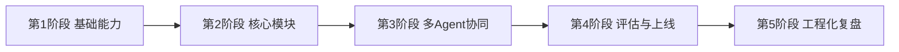
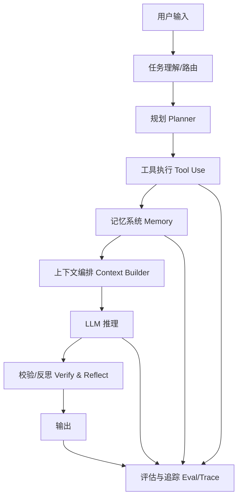
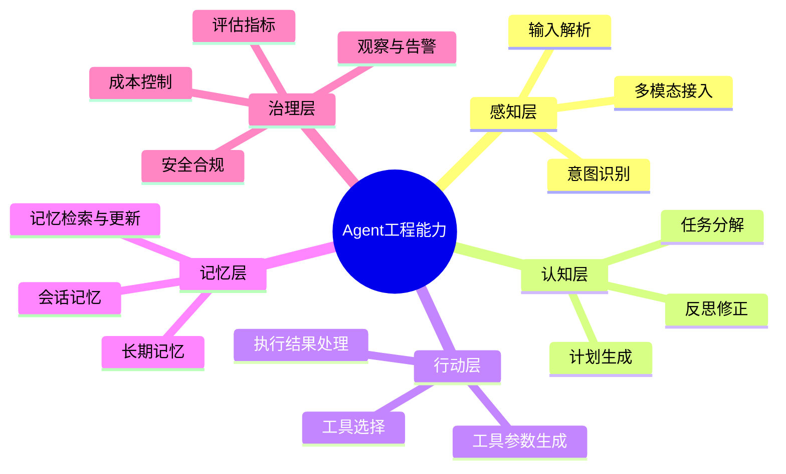
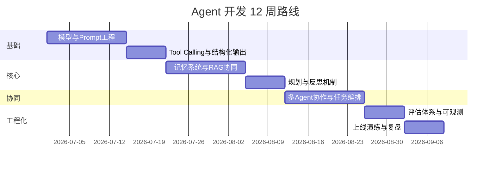
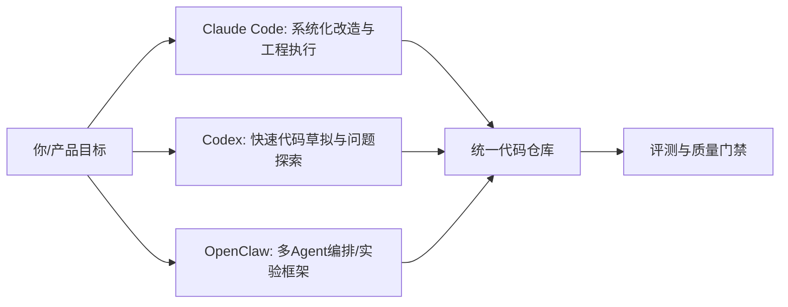
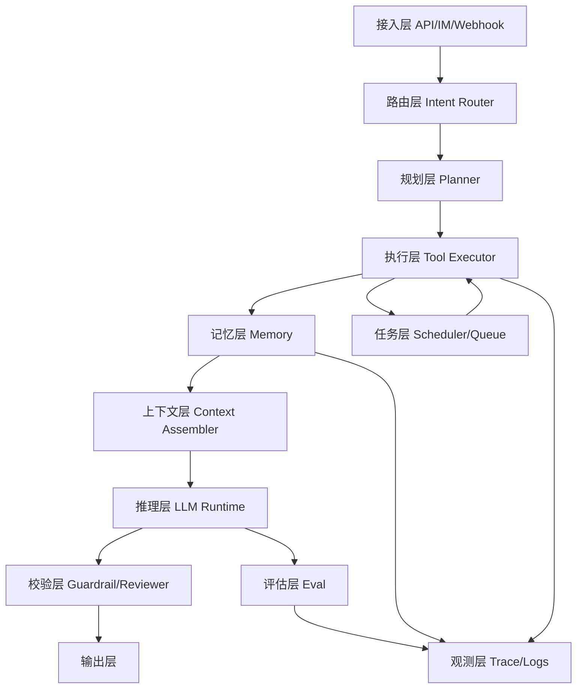
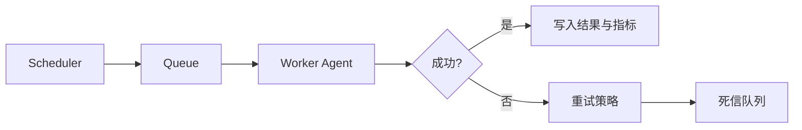
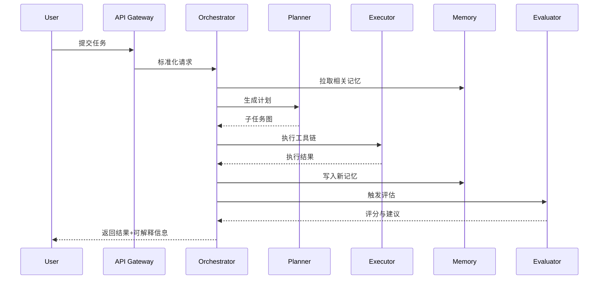

# Agent 开发学习路线图（含学习计划、目标、模块能力与 Claude Code/Codex/OpenClaw 管理实践）

> **abstract** 文档定位
> 这是一份面向实战的 Agent 开发路线文档，目标是让你在可控周期内，从“会调用模型”进阶到“能设计、实现、评估、运维多 Agent 系统”。

> **info** 适用人群
>
> 1. 已具备基础编程能力（Node.js/Python 任一均可）
> 2. 想从 RAG/Prompt 工程升级到 Agent 工程
> 3. 需要系统掌握 Claude Code、Codex、OpenClaw 等 Agent 工具与协作管理

---

## 目录（Obsidian）

- [1. 学习总目标与阶段成果](#1-学习总目标与阶段成果)
- [2. Agent 开发全景图](#2-agent-开发全景图)
- [3. Agent 功能模块能力树](#3-agent-功能模块能力树)
- [4. 必须掌握的知识体系](#4-必须掌握的知识体系)
- [5. 12 周学习计划（可执行）](#5-12-周学习计划可执行)
- [6. Claude Code / Codex / OpenClaw 管理方法](#6-claude-code--codex--openclaw-管理方法)
- [7. 三层项目实战路线](#7-三层项目实战路线)
- [8. 评估指标与质量门禁](#8-评估指标与质量门禁)
- [9. 常见失败模式与修复策略](#9-常见失败模式与修复策略)
- [10. Obsidian 笔记组织模板](#10-obsidian-笔记组织模板)
- [11. 每周执行清单（直接打卡）](#11-每周执行清单直接打卡)
- [12. 90 天结项标准](#12-90-天结项标准)
- [13. 模块级技术蓝图（精准到功能点）](#13-模块级技术蓝图精准到功能点)
- [14. 框架层选型：可选框架、特点与适用边界](#14-框架层选型可选框架特点与适用边界)
- [15. 记忆层深度设计：CC 与 OC 的差异化方案](#15-记忆层深度设计cc-与-oc-的差异化方案)
- [16. 定时任务与异步执行层：从 Cron 到工作流引擎](#16-定时任务与异步执行层从-cron-到工作流引擎)
- [17. 模块串联：从请求进入到评估回流的完整链路](#17-模块串联从请求进入到评估回流的完整链路)
- [18. 参考 Agent 模式与可建设性建议](#18-参考-agent-模式与可建设性建议)

---

## 1. 学习总目标与阶段成果

### 1.1 总目标

在 12 周内实现以下能力闭环：

1. 能独立设计单 Agent 与多 Agent 系统架构
2. 能实现规划、工具调用、记忆、反思、评估等核心模块
3. 能使用 Claude Code、Codex、OpenClaw 做协同开发与运行治理
4. 能在真实业务场景中落地一个可观测、可评估、可演进的 Agent 项目

### 1.2 阶段成果



每阶段都必须有“可展示产物”：

1. 代码仓库可运行
2. 文档可复现
3. 指标可量化
4. 复盘可追踪

---

## 2. Agent 开发全景图

很多学习者的问题是“学了很多点，连不成系统”。下面给出全景视角。



你要学的，不是“一个 prompt 写法”，而是这条链路每个节点的设计原则与工程约束。

---

## 3. Agent 功能模块能力树

> **tip** 学习策略
> 先“能跑通”，再“能稳定”，最后“能规模化”。

### 3.1 能力树



### 3.2 模块清单与掌握标准

1. 输入路由模块
   - 掌握标准：能将不同类型请求正确分配到对应 Agent 或工作流

2. 规划模块（Planner）
   - 掌握标准：复杂任务可分解为可执行步骤，并支持失败重规划

3. 工具执行模块（Tool Use）
   - 掌握标准：能定义工具 schema、处理失败重试、隔离副作用

4. 记忆模块（Memory）
   - 掌握标准：会话记忆与长期记忆分层，具备去噪和冲突处理

5. 评估模块（Evaluation）
   - 掌握标准：有自动评估脚本，能量化通过率、稳定性、成本指标

6. 可观测模块（Observability）
   - 掌握标准：能追踪链路、定位失败步骤、归因性能瓶颈

---

## 4. 必须掌握的知识体系

### 4.1 模型与推理基础

1. Prompt 结构化设计（System/User/Tool）
2. 函数调用与结构化输出
3. 推理约束与幻觉控制
4. 温度、top_p、max_tokens 的任务化调参

### 4.2 工具与协议基础

1. JSON Schema、OpenAPI 基础
2. 工具超时、重试、幂等设计
3. MCP（Model Context Protocol）理念与接入方式

### 4.3 数据与记忆基础

1. PostgreSQL/Redis 基础
2. 向量检索与混合检索
3. 会话状态建模与长期记忆生命周期

### 4.4 工程与运维基础

1. 日志、指标、Tracing
2. CI/CD 与环境隔离
3. 安全策略（权限、敏感信息、审计）
4. 灰度发布与回滚机制

### 4.5 评估与产品化基础

1. 离线评测集构建
2. 在线反馈闭环
3. 任务成功率、路径效率、成本指标
4. 用户体验一致性

---

## 5. 12 周学习计划（可执行）

> **example** 节奏设计
> 每周建议投入 10-15 小时，结构为：
>
> 1. 理论学习 30%
> 2. 编码实践 50%
> 3. 复盘总结 20%

### 5.1 时间线总览



### 5.2 分周目标

#### 第 1-2 周：模型与工具调用基础

学习目标：

1. 掌握结构化 prompt
2. 完成一个可调用 2-3 个工具的最小 Agent

交付物：

1. `single-agent-demo`
2. 工具 schema 文档
3. 首次复盘记录

#### 第 3 周：状态管理与对话编排

学习目标：

1. 建立会话状态模型
2. 支持多轮上下文与中断恢复

交付物：

1. 会话持久化模块
2. 状态机草图

#### 第 4-5 周：记忆系统与检索

学习目标：

1. 区分短期/长期记忆
2. 实现“检索 -> 注入 -> 更新”闭环

交付物：

1. 记忆表结构与 API
2. 记忆命中评测脚本

#### 第 6 周：规划与反思

学习目标：

1. 加入 Planner
2. 加入失败后反思与重规划

交付物：

1. 计划树可视化
2. 失败重试策略配置

#### 第 7-8 周：多 Agent 协同

学习目标：

1. 设计 3 角色协作（Planner / Worker / Reviewer）
2. 解决任务交接与冲突

交付物：

1. 多 Agent Orchestrator
2. 交接协议文档

#### 第 9 周：评估体系

学习目标：

1. 建立自动化评测集
2. 形成“回归测试”能力

交付物：

1. eval 脚本
2. 指标 dashboard 草图

#### 第 10 周：可观测与稳定性

学习目标：

1. trace 全链路
2. 建立异常告警和失败归因

交付物：

1. tracing 接入
2. 错误分类报告

#### 第 11 周：上线演练

学习目标：

1. 灰度发布
2. 压测与回滚

交付物：

1. 发布清单
2. 回滚手册

#### 第 12 周：总结与作品集

学习目标：

1. 输出完整架构文档
2. 输出学习路线复盘

交付物：

1. Demo 演示视频
2. 架构设计文档
3. 个人能力图谱

---

## 6. Claude Code / Codex / OpenClaw 管理方法

> **warning** 核心原则
> 不要把工具当“替你思考的黑箱”。你需要为每个工具定义角色边界、输入输出契约和质量门禁。

### 6.1 角色定位建议



推荐分工：

1. Claude Code
   - 长链路任务执行
   - 大文件改造、跨模块重构
   - 稳定性和一致性优先

2. Codex
   - 快速脚手架、算法草案、实验脚本
   - 多思路并行探索
   - 速度优先，后续需严格验收

3. OpenClaw
   - 多 Agent 工作流编排
   - 任务交接与状态驱动
   - 实验性方案验证与自动化调度

### 6.2 协同管理模板

#### 模板 A：任务分配卡

```markdown
任务名：
目标：
输入约束：
输出标准：
分配工具：Claude Code / Codex / OpenClaw
验收方式：单测/集成/人工评审
失败回退策略：
```

#### 模板 B：质量门禁卡

```markdown
- [ ] 功能正确（Happy path）
- [ ] 边界场景处理
- [ ] 错误信息可追踪
- [ ] 代码风格与架构一致
- [ ] 测试通过率 >= 95%
- [ ] 成本与延迟在阈值内
```

### 6.3 三工具协同工作流

1. Codex 先做方案草拟和最小实现
2. Claude Code 负责工程化改造和质量提升
3. OpenClaw 进行多 Agent 流程编排与回归实验
4. 最终统一进主分支并跑评测

---

## 7. 三层项目实战路线

### 7.1 项目 A：单 Agent 助手（入门）

目标：

1. 具备对话、工具调用、会话记忆

最低功能：

1. 用户提问
2. 工具查询
3. 结构化输出

### 7.2 项目 B：多 Agent 任务系统（进阶）

目标：

1. 实现 Planner-Worker-Reviewer 协同

最低功能：

1. 任务拆解
2. 子任务并行
3. 结果审阅与修正

### 7.3 项目 C：可上线 Agent 平台（高级）

目标：

1. 具备评测、监控、灰度、回滚能力

最低功能：

1. 评测面板
2. 异常告警
3. 版本管理

---

## 8. 评估指标与质量门禁

### 8.1 指标体系

1. 任务成功率（Task Success Rate）
2. 平均工具调用次数（Tool Steps）
3. 平均完成时延（Latency）
4. 平均单任务成本（Cost）
5. 失败可恢复率（Recoverability）

### 8.2 指标目标建议

```mermaid
xychart-beta
		title "Agent 项目阶段指标目标"
		x-axis [阶段1, 阶段2, 阶段3, 阶段4]
		y-axis "百分比/相对值" 0 --> 100
		bar [55, 68, 80, 88]
		line [40, 55, 72, 85]
```

说明：

1. 柱状可表示任务成功率
2. 折线可表示评测通过率

---

## 9. 常见失败模式与修复策略

### 9.1 失败模式：工具调用失控

表现：

1. 无意义重复调用
2. 参数错误连锁失败

修复：

1. 增加调用预算和终止条件
2. 工具输入参数预校验

### 9.2 失败模式：记忆污染

表现：

1. 低质量信息进入长期记忆

修复：

1. 引入置信度阈值
2. 增加人工审核或自动降权

### 9.3 失败模式：多 Agent 冲突

表现：

1. 子 Agent 结论互相矛盾

修复：

1. 引入 Reviewer 统一裁决
2. 给每个结论附证据和可信度

---

## 10. Obsidian 笔记组织模板

> **tip** 推荐组织法
> 用“路线图 + 周计划 + 实验记录 + 复盘总结”四类文档管理学习过程。

```text
Agent-Learning/
	00-路线图/
		agent学习路线图.md
	01-周计划/
		week-01.md
		week-02.md
	02-实验记录/
		exp-tool-calling.md
		exp-memory.md
	03-复盘总结/
		review-month-1.md
	04-模板/
		task-card-template.md
		eval-template.md
```

每篇实验记录建议固定结构：

1. 目标
2. 方法
3. 结果
4. 问题
5. 下次改进

---

## 11. 每周执行清单（直接打卡）

### 11.1 周通用模板

- [ ] 明确本周目标（最多 3 个）
- [ ] 完成 1 个可运行 demo
- [ ] 写 1 次实验记录
- [ ] 跑 1 次评测并记录指标
- [ ] 做 1 次复盘（问题、改进、下周计划）

### 11.2 每日最小行动

1. 学习 45 分钟（理论）
2. 编码 60 分钟（实践）
3. 记录 15 分钟（复盘）

---

## 12. 90 天结项标准

结项前请自检以下条件：

1. 至少完成 2 个 Agent 项目（单 Agent + 多 Agent）
2. 至少有 1 个项目具备评测和可观测能力
3. 能清晰讲出 Claude Code、Codex、OpenClaw 的分工与治理策略
4. 能提供完整文档：架构图、时序图、模块说明、评测报告
5. 能完成一次“从需求到上线”的全流程演示

> **success** 结项标志
> 当你能稳定回答“为什么这样设计、失败如何恢复、指标如何验证”，说明你已经从“会用 Agent”进入“会做 Agent 工程”的阶段。

---

## 13. 模块级技术蓝图（精准到功能点）

你提出的重点是对的：路线图如果不落到具体功能点，就难执行。下面给出工程可拆分的模块蓝图。



### 13.1 功能点最小清单

1. 路由层
   - 意图分类
   - 模型选择策略
   - 回退策略（降级到简单问答）

2. 规划层
   - 任务拆解
   - 子任务依赖图
   - 重规划触发条件

3. 执行层
   - 工具 schema 注册
   - 参数校验与超时控制
   - 幂等与重试机制

4. 记忆层
   - 短期记忆（会话窗口）
   - 长期记忆（用户/任务画像）
   - 记忆冲突处理和过期策略

5. 任务层
   - 定时任务
   - 延迟任务
   - 补偿任务

6. 评估层
   - 离线基准集
   - 在线抽样评估
   - 回归评估门禁

---

## 14. 框架层选型：可选框架、特点与适用边界

> **info** 选型原则
> 不追求“最强框架”，而追求“与你的团队规模、语言栈、业务复杂度匹配”。

### 14.1 框架对比表

| 框架                  | 语言           | 核心能力                          | 适用场景                                | 短板                         |
| --------------------- | -------------- | --------------------------------- | --------------------------------------- | ---------------------------- |
| LangGraph             | Python/JS      | 状态图编排、可恢复执行、检查点    | 需要复杂工作流和可追踪状态的 Agent 系统 | 学习曲线中等，状态建模要求高 |
| AutoGen               | Python         | 多 Agent 对话协作、角色分工       | 多 Agent 协作实验、研究原型             | 工程化治理需要自行补足       |
| CrewAI                | Python         | 角色任务编排、团队式 Agent        | 任务拆分明确的业务流程                  | 对复杂状态恢复支持一般       |
| Semantic Kernel       | C#/Python/Java | 企业集成、插件体系、函数编排      | 企业内网、强工程治理场景                | 社区样例碎片化               |
| OpenClaw（OC）        | 视具体实现而定 | 多 Agent 管理、流程调度、实验驱动 | 需要快速验证多 Agent 管理策略           | 不同实现差异大，需自行定规范 |
| 轻量自研 Orchestrator | Node/Python    | 高可控、与现有系统深度耦合        | 已有强后端团队，追求定制化              | 前期建设成本高               |

### 14.2 选型建议

1. 个人学习或小团队
   - 首选 LangGraph 或轻量自研
2. 研究多 Agent 协作
   - 首选 AutoGen 或 OpenClaw
3. 企业级治理优先
   - Semantic Kernel 或 LangGraph + 自建治理层

---

## 15. 记忆层深度设计：CC 与 OC 的差异化方案

> **warning** 关键认知
> 记忆不是“把历史对话都存起来”，而是“存可复用且可治理的信息”。

### 15.1 记忆层标准分层

1. L1 会话记忆
   - 当前会话窗口，生命周期短
2. L2 任务记忆
   - 某个任务周期内有效（如工单、项目）
3. L3 长期记忆
   - 用户偏好、稳定约束、历史决策

### 15.2 CC 与 OC 的处理差异

| 维度     | Claude Code（CC）倾向                          | OpenClaw（OC）倾向                                   |
| -------- | ---------------------------------------------- | ---------------------------------------------------- |
| 核心重心 | 单任务深执行、代码改造链路                     | 多 Agent 协作与任务编排                              |
| 记忆重点 | 仓库上下文、开发约束、会话连续性               | 任务状态、Agent 交接上下文、流程事件                 |
| 存储建议 | Repo memory + session memory + user preference | Workflow state store + event log + shared memory bus |
| 更新策略 | 每轮后抽取高价值偏好/约束                      | 每阶段节点写入状态快照与决策依据                     |
| 冲突策略 | 最近高置信版本优先                             | Reviewer Agent 仲裁 + 证据回溯                       |

### 15.3 具体做法

1. CC 场景（开发助手）
   - 存：代码风格、目录规范、常用命令、禁用操作
   - 不存：临时情绪、一次性闲聊
   - 检索：优先最近 7 天 + 高置信偏好

2. OC 场景（多 Agent 编排）
   - 存：节点输入输出、任务状态、失败原因、交接摘要
   - 不存：无证据结论
   - 检索：按任务实例和节点角色过滤

3. 统一治理建议
   - 记忆写入必须经过阈值门控
   - 长期记忆必须支持版本化
   - 敏感信息必须脱敏或拒写

---

## 16. 定时任务与异步执行层：从 Cron 到工作流引擎

很多 Agent 项目后期失败，不是推理不行，而是“任务调度失控”。

### 16.1 三类任务模型

1. 固定周期任务
   - 每日摘要、每周复盘、知识库重建
2. 延迟任务
   - 30 分钟后回访、24 小时后质量复检
3. 补偿任务
   - 工具失败重跑、外部接口超时补偿

### 16.2 技术实现选项

| 层级   | 可选技术                            | 适用场景                   |
| ------ | ----------------------------------- | -------------------------- |
| 轻量   | node-cron / schedule                | 单机或小规模定时任务       |
| 队列   | BullMQ / Celery / Sidekiq 类        | 需要重试、延迟、并发控制   |
| 工作流 | Temporal / Airflow / Argo Workflows | 复杂长流程、强可恢复与审计 |

### 16.3 定时任务设计清单

1. 幂等键
2. 任务超时
3. 重试上限
4. 死信队列
5. 告警阈值
6. 任务版本号



---

## 17. 模块串联：从请求进入到评估回流的完整链路

### 17.1 串联时序



### 17.2 串联建设建议

1. 先统一请求协议（输入、输出、错误码）
2. 再统一状态协议（任务状态、节点状态）
3. 最后统一评估协议（指标名、阈值、回归规则）

没有协议统一，多模块一定会碎片化。

---

## 18. 参考 Agent 模式与可建设性建议

### 18.1 可参考的 Agent 模式

1. Claude Code 模式
   - 优势：长链路代码任务执行稳定
   - 可借鉴：任务分解 + 文件级变更 + 结果验证

2. Codex 模式
   - 优势：快速生成候选实现
   - 可借鉴：多方案并行探索与快速原型

3. OpenClaw 模式
   - 优势：多 Agent 编排和管理
   - 可借鉴：角色化协作、任务交接、过程化治理

4. ReAct 模式
   - 优势：推理-行动交替，便于可解释
   - 可借鉴：每步都附“为什么调用这个工具”

### 18.2 可建设性建议（按优先级）

1. P0 先做最小可用闭环
   - 输入路由 + 工具调用 + 基础记忆 + 日志追踪

2. P1 再做可靠性
   - 事务化状态更新、重试策略、超时与降级

3. P2 最后做规模化
   - 多 Agent 编排、评估自动化、发布治理

4. 每周必须做一次失败案例复盘
   - 记录失败类型、根因、修复动作、防回归策略

> **success** 你可以立刻开始的 7 天计划
>
> 1. 选定一个编排框架（LangGraph 或 OpenClaw）
> 2. 完成 3 个工具接入（检索、数据库、通知）
> 3. 搭建会话记忆 + 任务状态表
> 4. 增加一个定时复盘任务
> 5. 建立最小评估脚本（成功率、时延、成本）
> 6. 用 Claude Code 做工程化重构
> 7. 用 Codex 做对照实验并写复盘

---

## 附录：一页执行版（可贴墙）

1. 先打基础：Prompt + Tool + State
2. 再建核心：Memory + Planner + Reflect
3. 再做协同：Multi-Agent + Orchestrator
4. 最后工程化：Eval + Trace + Release

一句话收束：

从“写一个会答话的机器人”，到“构建可控可评估可迭代的智能系统”，中间差的是工程化学习路线，而这份文档就是你的执行地图。
