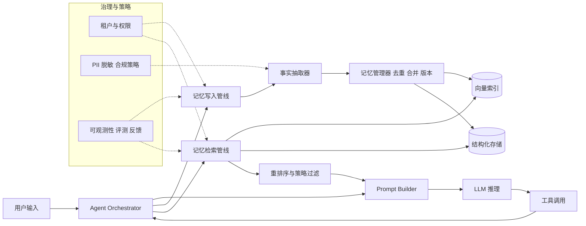
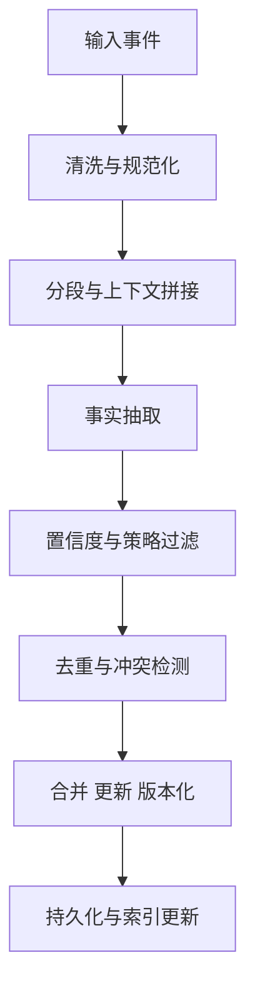
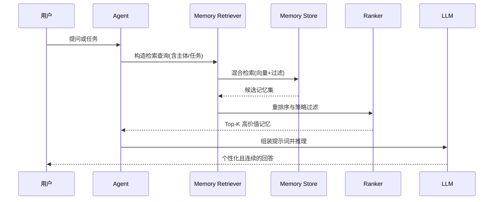
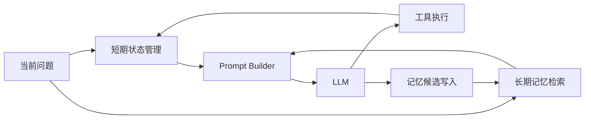
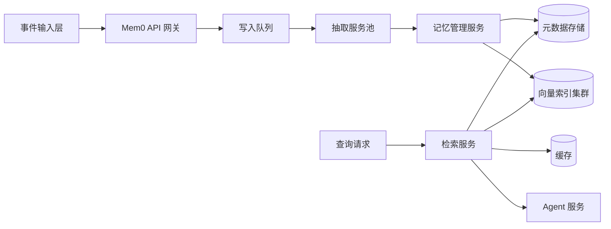

# mem0 学习笔记：从架构设计到 Agent 落地的系统化拆解

## 0. 为什么要单独研究 mem0

做 Agent 的人通常会经历一个阶段：

1. 最开始只靠上下文窗口硬塞历史消息。
2. 后来加了 RAG，把历史对话丢进向量库检索。
3. 再后来发现仍然不够用，因为“记忆”不只是相似检索，而是需要长期演化、冲突消解、时序优先级、多用户隔离和策略治理。

mem0 的价值，正是在第 3 步：它尝试把“记忆系统”作为独立基础设施，从“聊天记录存档”升级为“可被 Agent 稳定调用的长期记忆层”。

如果把 Agent 看成一个会思考和行动的系统，那么可以粗略拆成：

- 大脑：LLM 推理
- 感官：输入通道（消息、文档、工具结果）
- 肌肉：工具调用与执行器
- 记忆：短期状态 + 长期用户画像 + 任务知识沉淀

很多项目的大脑在升级，肌肉在扩展，但记忆还是“日志+向量库”，这会直接限制 Agent 的连续性、个性化和稳定性。mem0 的目标就是补上这一层。

---

## 1. mem0 的核心定位

一句话：

mem0 不是单纯的 Vector DB，也不是普通 Chat History，而是面向 Agent 的长期记忆管理系统。

它关心的问题包括：

- 记什么：从原始对话中抽取“值得长期保存”的事实
- 怎么记：结构化存储、去重、合并、版本更新
- 何时记：写入策略、置信度阈值、隐私过滤
- 怎么取：按任务语义检索、按时序衰减、按用户与场景隔离
- 怎么用：在 Agent 推理前注入有效记忆，减少无关噪声

这意味着它通常具备三类能力：

1. 记忆抽取（Memory Extraction）
2. 记忆管理（Memory Management）
3. 记忆检索与注入（Memory Retrieval + Injection）

---

## 2. 架构总览

下面用一张总览图说明 mem0 在 Agent 系统中的位置。



从工程上看，mem0 可以分成四层：

1. 接入层
   - 接收对话消息、工具结果、任务事件
   - 标注 user_id、agent_id、session_id、tenant_id

2. 记忆处理层
   - 抽取事实
   - 去重、冲突检测、合并更新
   - 置信度评估与策略判定

3. 存储与检索层
   - 结构化存储：事实、来源、版本、标签、时间戳
   - 向量索引：语义召回
   - 可选关键词索引：高精度过滤

4. 注入与治理层
   - 检索结果重排序
   - 按 token 预算进行上下文组装
   - 权限隔离、隐私策略、审计日志

---

## 3. 关键数据模型设计

### 3.1 事件模型

写入入口通常不是“直接给我一条记忆”，而是输入事件流：

- 用户消息
- Agent 回复
- 工具输出
- 外部系统状态更新

事件最少要有：

- subject（记忆主体，比如某用户）
- actor（谁说的）
- content（文本或结构化内容）
- context（会话、任务、渠道）
- timestamp（时间）
- source_ref（来源引用）

### 3.2 记忆对象模型

一条可管理记忆通常应包含：

- memory_id：唯一标识
- subject_id：所属主体（用户、团队、实体）
- type：偏好、事实、计划、约束、历史结果
- content：规范化后的事实文本
- slots：结构化槽位（如城市、预算、语言）
- confidence：置信度
- salience：显著性
- recency：近期性
- embedding：向量
- created_at / updated_at / last_accessed_at
- source_links：来源追踪
- version：版本号
- status：active、deprecated、deleted

### 3.3 元信息与可追溯性

可追溯性是“记忆系统”区别于“黑盒检索”的关键。至少要支持：

- 这条记忆来自哪段对话
- 为什么被更新或覆盖
- 何时被哪些推理步骤使用过
- 使用后效果如何（正反馈、负反馈）

这直接关系到调试效率与合规审计能力。

---

## 4. 写入路径实现原理

写入路径决定了记忆质量上限。一个实用的写入管线可拆为 7 步。



### 4.1 清洗与规范化

目标是把脏文本变成可抽取对象：

- 去掉无意义寒暄
- 标准化时间表达（下周一 -> 具体日期）
- 标准化单位（美元、人民币、小时）
- 统一实体别名（小王、王老师 -> 同一用户）

### 4.2 事实抽取

常用做法：

1. 规则+LLM 混合
2. 纯 LLM 结构化输出（JSON Schema）

建议抽取结果包含：

- fact_text
- fact_type
- confidence
- evidence_span
- mutable（未来是否可能变化）

### 4.3 策略过滤

并非所有事实都值得存。

可以设计一个写入评分：

$$
Score_{write} = w_1 \cdot Confidence + w_2 \cdot Salience + w_3 \cdot Novelty - w_4 \cdot PrivacyRisk
$$

当 $Score_{write}$ 超过阈值才写入。这样可以减少“低价值噪声记忆”。

### 4.4 去重与冲突检测

去重不是只看文本相似度，还要看语义槽位：

- 文本相近但时效不同：可能是更新，不是重复
- 文本不同但槽位冲突：可能是事实变更

典型策略：

- 先向量粗召回候选
- 再规则精比较（subject + type + key slots）
- 最后交给 LLM 判断 relation：same、update、conflict、independent

### 4.5 版本化合并

对可变事实（如偏好、当前目标）建议保留版本链：

- v1: 喜欢早晨跑步
- v2: 最近改为晚上跑步

读取时默认取最新 active 版本，但保留历史用于解释与回滚。

### 4.6 索引更新

至少两类索引：

- 语义向量索引：召回语义相关记忆
- 结构化过滤索引：按 type、时间、标签快速过滤

当写入量变大时，可采用异步索引更新队列，降低写请求延迟。

---

## 5. 读取路径实现原理

读取路径目标不是“找最多记忆”，而是“找最有用且最安全的记忆”。



### 5.1 查询理解

读取前先把用户问题转成检索意图：

- 本轮是偏好查询还是任务延续
- 需要长期记忆还是近期会话状态
- 是否涉及敏感主题（需策略降级）

### 5.2 混合检索

推荐使用：

- 向量召回：保证语义覆盖
- 结构化过滤：保证精准度
- 时间窗加权：最近相关事实优先

### 5.3 重排序

可以用综合评分：

$$
Score_{read} = a\cdot Relevance + b\cdot Recency + c\cdot Reliability + d\cdot TaskFit
$$

并叠加硬规则：

- 禁止越权主体记忆
- 禁止注入敏感字段
- 限制同类型重复注入条数

### 5.4 上下文组装

常见错误是把检索结果原样拼进 prompt，导致噪声高、token 爆炸。

更好的方式：

1. 先归类（偏好、约束、历史决策）
2. 对每类做摘要压缩
3. 给每条记忆附来源和置信度
4. 控制总 token 预算

---

## 6. mem0 的能力矩阵（功能视角）

从产品能力看，可按以下维度评估一个 mem0 系统是否成熟。

| 维度 | 基础能力   | 进阶能力                       |
| ---- | ---------- | ------------------------------ |
| 采集 | 对话写入   | 多源事件写入（工具、业务系统） |
| 抽取 | 关键词抽取 | 结构化事实抽取+置信度          |
| 管理 | 简单存储   | 去重、冲突消解、版本链         |
| 检索 | 向量召回   | 混合检索+重排序+策略           |
| 注入 | 直接拼接   | 分层注入+预算控制+可解释       |
| 治理 | 基础鉴权   | 多租户、PII、审计与回放        |
| 评测 | 主观观察   | 自动化离线评测+在线反馈闭环    |

---

## 7. 与 Agent 的搭配方式

### 7.1 单 Agent：短期状态 + 长期记忆

建议使用“双层记忆”模型：

- 短期状态：当前任务临时变量（session 级）
- 长期记忆：跨会话稳定事实（user 级）

这样可以避免把临时状态误写入长期存储。



### 7.2 多 Agent：共享记忆与私有记忆并存

多 Agent 场景常见问题：

- 共享记忆污染
- 角色越权读取
- 并发更新冲突

实操建议：

1. 共享层存“客观事实与团队决策”。
2. 私有层存“角色偏好与中间推理痕迹”。
3. 写入时做命名空间隔离，例如 tenant/team/agent/user。
4. 关键字段使用乐观锁版本号，避免并发覆盖。

### 7.3 ReAct 与 Tool Calling 模式

在 ReAct 流程中，记忆可注入到两个节点：

- Thought 前：提供背景事实
- Act 前：提供工具调用偏好与历史失败模式

在 Tool Calling 流程中，记忆还可以参与参数补全，例如默认时区、默认货币、常用项目编号。

---

## 8. 与 LangChain 搭配的实战方式（JavaScript）

下面给出一套可直接改造的 Node.js + LangChain 风格示例。接口命名可能随 mem0 版本变化，但架构思路通用。

### 8.1 目标

实现一个客服 Agent：

- 每轮对话先检索用户长期记忆
- 再调用模型生成回答
- 最后从本轮消息中抽取并写入新记忆

### 8.2 代码示例：封装 mem0 客户端

```javascript
import fetch from "node-fetch";

export class Mem0Client {
  constructor({ baseUrl, apiKey }) {
    this.baseUrl = baseUrl;
    this.apiKey = apiKey;
  }

  async searchMemories({ userId, query, topK = 8, filters = {} }) {
    const res = await fetch(`${this.baseUrl}/v1/memories/search`, {
      method: "POST",
      headers: {
        "Content-Type": "application/json",
        Authorization: `Bearer ${this.apiKey}`,
      },
      body: JSON.stringify({ user_id: userId, query, top_k: topK, filters }),
    });
    if (!res.ok) throw new Error(`searchMemories failed: ${res.status}`);
    return res.json();
  }

  async addMemoryEvent({ userId, messages, metadata = {} }) {
    const res = await fetch(`${this.baseUrl}/v1/memories`, {
      method: "POST",
      headers: {
        "Content-Type": "application/json",
        Authorization: `Bearer ${this.apiKey}`,
      },
      body: JSON.stringify({ user_id: userId, messages, metadata }),
    });
    if (!res.ok) throw new Error(`addMemoryEvent failed: ${res.status}`);
    return res.json();
  }
}
```

### 8.3 代码示例：接入 LangChain 生成链路

```javascript
import { ChatOpenAI } from "@langchain/openai";
import { HumanMessage, SystemMessage } from "@langchain/core/messages";
import { Mem0Client } from "./mem0-client.js";

const llm = new ChatOpenAI({
  model: "gpt-4o-mini",
  temperature: 0.2,
});

const mem0 = new Mem0Client({
  baseUrl: process.env.MEM0_BASE_URL,
  apiKey: process.env.MEM0_API_KEY,
});

function renderMemories(memories = []) {
  if (!memories.length) return "无长期记忆可用";
  return memories
    .map((m, i) => {
      const conf = m.confidence ?? "unknown";
      return `${i + 1}. ${m.content} (confidence=${conf})`;
    })
    .join("\n");
}

export async function replyWithMemory({ userId, userInput }) {
  const memoryResult = await mem0.searchMemories({
    userId,
    query: userInput,
    topK: 6,
    filters: { status: "active" },
  });

  const memoryText = renderMemories(memoryResult?.items || []);

  const systemPrompt = [
    "你是一个可靠的智能客服助手。",
    "请优先遵循事实，不编造信息。",
    "以下是与当前问题相关的长期记忆，请按需使用：",
    memoryText,
  ].join("\n\n");

  const response = await llm.invoke([
    new SystemMessage(systemPrompt),
    new HumanMessage(userInput),
  ]);

  await mem0.addMemoryEvent({
    userId,
    messages: [
      { role: "user", content: userInput },
      { role: "assistant", content: response.content },
    ],
    metadata: {
      channel: "support-chat",
      model: "gpt-4o-mini",
    },
  });

  return response.content;
}
```

### 8.4 代码示例：在 AgentExecutor 前置记忆检索

```javascript
import { AgentExecutor, createToolCallingAgent } from "langchain/agents";
import { ChatPromptTemplate } from "@langchain/core/prompts";

export async function buildAgentWithMem0({ llm, tools, mem0, userId }) {
  const prompt = ChatPromptTemplate.fromMessages([
    [
      "system",
      "你是一个任务型 Agent，请结合长期记忆与工具能力完成任务。\n{memory_context}",
    ],
    ["human", "{input}"],
    ["placeholder", "{agent_scratchpad}"],
  ]);

  const agent = await createToolCallingAgent({ llm, tools, prompt });
  const executor = new AgentExecutor({ agent, tools, verbose: true });

  return {
    async invoke(input) {
      const memories = await mem0.searchMemories({
        userId,
        query: input,
        topK: 10,
      });

      const memoryContext = (memories.items || [])
        .map((m) => `- ${m.content}`)
        .join("\n");

      const result = await executor.invoke({
        input,
        memory_context: memoryContext || "- 暂无相关长期记忆",
      });

      await mem0.addMemoryEvent({
        userId,
        messages: [
          { role: "user", content: input },
          { role: "assistant", content: String(result.output ?? "") },
        ],
        metadata: { pipeline: "agent-executor" },
      });

      return result;
    },
  };
}
```

这三段代码的关键价值在于：

- 检索在前，生成在后
- 生成后立即反哺记忆
- 通过 user_id 进行主体隔离

---

## 9. 典型落地场景

### 9.1 客服 Agent

记忆内容：

- 用户历史问题类型
- 已尝试过的排障步骤
- 用户偏好的沟通风格与时间

收益：

- 降低重复问答
- 提升一次解决率
- 回答风格更稳定

### 9.2 编程 Copilot 类 Agent

记忆内容：

- 用户偏好语言、框架、测试风格
- 仓库约定（命名、目录、提交规范）
- 历史修复过的问题模式

收益：

- 减少建议与项目风格冲突
- 降低重复解释成本
- 提高 patch 一次通过率

### 9.3 学习助手 Agent

记忆内容：

- 学习进度与薄弱知识点
- 偏好例子类型（图解、代码、类比）
- 复习周期与测验表现

收益：

- 个性化路径更精准
- 长周期学习连续性更强

---

## 10. 评测体系与效果衡量

没有评测的记忆系统，很难持续优化。建议至少跟踪以下指标。

### 10.1 写入质量指标

- Memory Precision：写入中真正有价值的比例
- Duplication Rate：重复写入率
- Conflict Error Rate：冲突处理错误率

### 10.2 检索质量指标

- Recall@K：相关记忆召回率
- nDCG：排序质量
- Context Utility：注入记忆对最终回答帮助度

### 10.3 业务效果指标

- 首次问题解决率提升
- 用户满意度提升
- 对话轮次降低
- Token 成本变化

### 10.4 在线反馈闭环

应建立“记忆使用反馈”通道：

- 用户显式反馈（这不是我的偏好）
- Agent 自检反馈（使用后造成回答偏差）

再将反馈写回记忆状态，例如把错误记忆标记为 deprecated。

---

## 11. 安全、隐私与合规设计

记忆系统越强，安全要求越高。

### 11.1 最小化原则

- 不必要不存
- 敏感字段默认脱敏
- 限制记忆保留期限

### 11.2 访问控制

- 强制租户隔离
- 按角色控制读写范围
- 管理员审计日志可追踪

### 11.3 可删除与可纠错

应支持：

- 按主体删除
- 按类型批量删除
- 纠错覆盖并保留审计轨迹

这在企业环境和监管场景下是刚需。

---

## 12. 部署与扩展建议

### 12.1 小规模阶段

- 单实例 API + 托管向量库
- 同步写入、同步索引
- 先保证正确性再优化吞吐

### 12.2 中规模阶段

- 写入异步化（消息队列）
- 检索服务独立扩容
- 增加缓存层（热点记忆）

### 12.3 大规模阶段

- 分片与多副本
- 多级存储（热、温、冷）
- 离线重建索引管线



---

## 13. mem0 与 RAG、向量库、传统会话记忆的区别

### 13.1 与纯 RAG 的区别

RAG 核心处理“文档知识召回”，而 mem0 更关注“用户与任务事实的长期演化”。

### 13.2 与向量库的区别

向量库解决“怎么搜”，mem0 还解决“该不该存、怎么管、怎么演化、怎么安全地注入”。

### 13.3 与 Chat History 的区别

Chat History 更像流水账，mem0 强调“提炼后的可用记忆资产”。

---

## 14. 常见误区与反模式

1. 把所有对话都写入长期记忆
   - 后果：噪声失控，检索污染

2. 只做向量检索不做结构化过滤
   - 后果：召回看似相关但业务不适配

3. 不做冲突处理
   - 后果：同一事实出现多版本互相打架

4. 不做可追溯
   - 后果：出现错误答案无法定位源头

5. 不做权限隔离
   - 后果：跨用户数据泄漏风险极高

---

## 15. 一个可执行的落地蓝图

如果你准备从 0 到 1 上 mem0，建议按 4 个里程碑推进。

### 里程碑 1：可用

- 接入写入 API 和检索 API
- 仅存偏好类与约束类记忆
- 在 prompt 中注入 Top-3 记忆

### 里程碑 2：可控

- 增加去重与冲突规则
- 建立记忆审计面板
- 增加记忆删除与更正入口

### 里程碑 3：可优化

- 做离线评测集
- 做检索重排序 A/B
- 引入反馈闭环更新记忆状态

### 里程碑 4：可规模化

- 写入异步化
- 分层缓存
- 多租户治理策略体系化

---

## 16. 参考 Prompt 模板

### 16.1 事实抽取模板

```text
你是一个记忆抽取器。请从给定对话中提取值得长期保存的事实。
要求：
1) 仅提取稳定或高价值事实；
2) 输出 JSON 数组；
3) 每条包含 fact_text, fact_type, confidence(0~1), mutable(boolean), evidence_span。
4) 不要输出任何额外解释。
```

### 16.2 冲突判定模板

```text
你将收到 candidate_fact 与 existing_facts。
请判断关系：same / update / conflict / independent。
如果是 update，给出被更新的 memory_id。
如果是 conflict，给出冲突点说明与建议处理策略。
输出 JSON。
```

### 16.3 注入压缩模板

```text
请将候选记忆按以下类别压缩：
- 用户偏好
- 任务约束
- 历史决策
每类最多 3 条，每条不超过 30 字，保留置信度。
```

---

## 17. 最终理解：把 mem0 当成“记忆操作系统”

如果只把 mem0 当成一个“存和搜”的 SDK，很容易用到瓶颈。

更准确的理解是：

mem0 是 Agent 时代的记忆操作系统，负责长期事实资产的生命周期管理。

它的长期价值在于三件事：

1. 连续性：让 Agent 跨会话保持稳定人格与上下文
2. 可靠性：减少幻觉式个性化，提升事实一致性
3. 经营性：把对话沉淀成可运营、可治理、可评测的数据资产

当你的 Agent 进入生产环境，用户规模和会话长度增长后，记忆层很快会从“可选”变成“基础设施”。这正是 mem0 在架构中的真实位置。

---

## 18. 一页总结（便于复习）

- mem0 的核心不是“存更多”，而是“存对、取准、可控、可解释”。
- 写入链路要重视抽取质量、去重冲突、版本治理。
- 读取链路要重视混合检索、重排序和策略注入。
- 与 Agent 结合时，优先采用短期状态 + 长期记忆双层模型。
- 与 LangChain 集成时，形成 检索 -> 生成 -> 反哺写入 闭环。
- 生产落地必须同步建设评测、安全与审计体系。

如果只做一个行动建议：

先让记忆系统“可追溯”，再让它“更聪明”。
