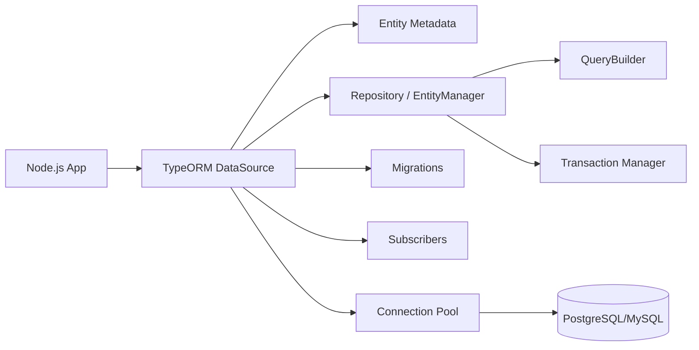
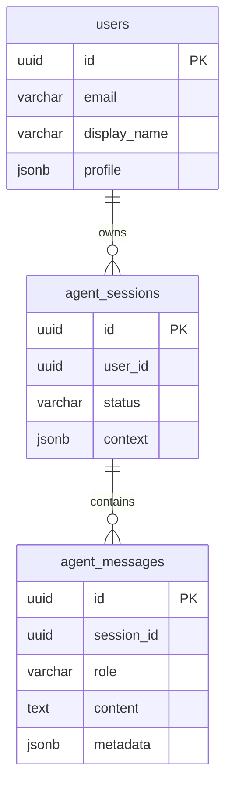
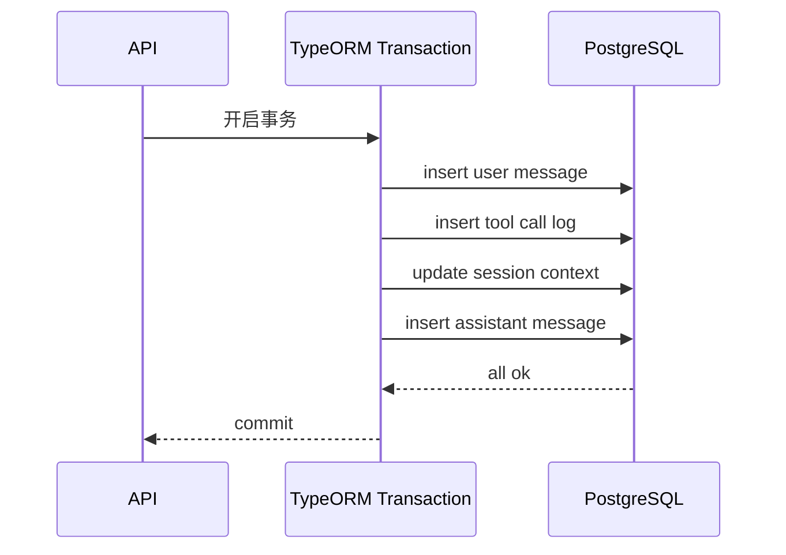
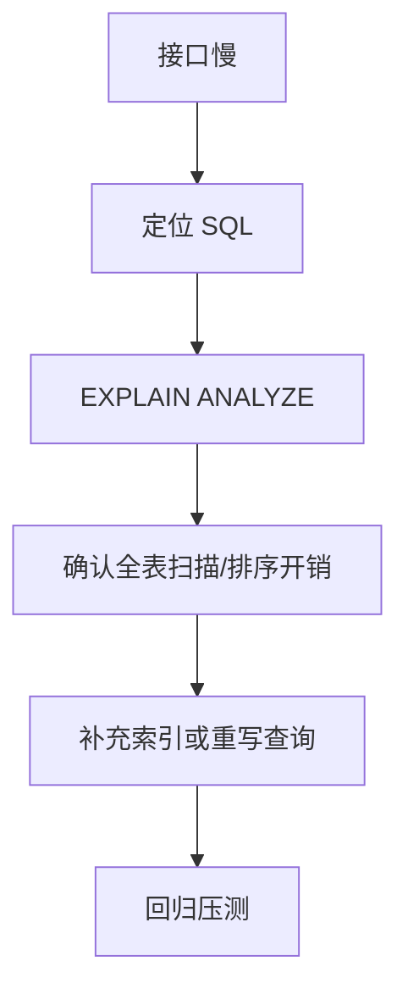
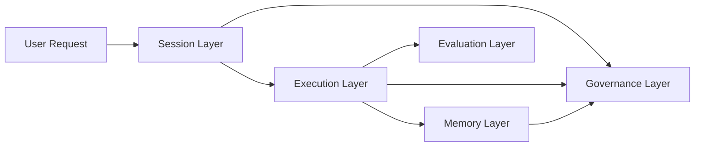
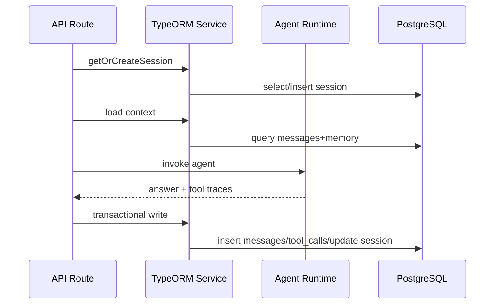
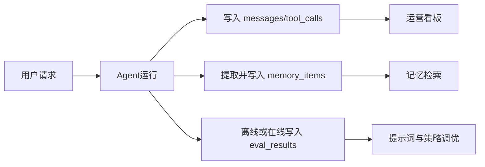

# TypeORM 在 Node.js 中的系统学习笔记（面向 Agent 开发）

> **abstract** 阅读导航
> 这是一份面向 Node.js 与 Agent 工程化落地的 TypeORM 笔记。
> 如果你要快速上手，优先看第 3、4、5、8、9、14、20、21 节。

## 目录（Obsidian）

- [0. 这份文档解决什么问题](#0-这份文档解决什么问题)
- [1. TypeORM 的定位与核心价值](#1-typeorm-的定位与核心价值)
- [2. TypeORM 的整体架构图](#2-typeorm-的整体架构图)
- [3. 快速起步：Node.js 项目初始化](#3-快速起步nodejs-项目初始化)
- [4. DataSource：运行时入口](#4-datasource运行时入口)
- [5. 实体建模：先建业务语言，再建表](#5-实体建模先建业务语言再建表)
- [6. 关系映射与加载策略](#6-关系映射与加载策略)
- [7. Repository 与 QueryBuilder：实用对比](#7-repository-与-querybuilder实用对比)
- [8. 迁移（Migration）：生产可维护的关键](#8-迁移migration生产可维护的关键)
- [9. 事务与一致性：Agent 场景的生命线](#9-事务与一致性agent-场景的生命线)
- [10. 锁与并发控制](#10-锁与并发控制)
- [11. 软删除、审计、可追溯](#11-软删除审计可追溯)
- [12. 索引与性能优化](#12-索引与性能优化)
- [13. TypeORM 在 Agent 开发中的完整数据分层](#13-typeorm-在-agent-开发中的完整数据分层)
- [14. Node.js + TypeORM + Agent 的关键实战代码](#14-nodejs--typeorm--agent-的关键实战代码)
- [15. 与 LangChain/Agent 框架的协作方式](#15-与-langchainagent-框架的协作方式)
- [16. 测试策略：别只测接口，要测迁移与事务](#16-测试策略别只测接口要测迁移与事务)
- [17. 常见坑位与规避建议](#17-常见坑位与规避建议)
- [18. 一套可执行的学习路径（2 周）](#18-一套可执行的学习路径2-周)
- [19. 结语：把 TypeORM 当作 Agent 的“状态底座”](#19-结语把-typeorm-当作-agent-的状态底座)
- [20. NestJS 专章：TypeORM 在模块化 Agent 服务中的落地](#20-nestjs-专章typeorm-在模块化-agent-服务中的落地)
- [21. Agent 记忆表与评测表：SQL 与 Entity 对照设计](#21-agent-记忆表与评测表sql-与-entity-对照设计)
- [22. 增强版小结与落地顺序](#22-增强版小结与落地顺序)
- [附录 A：常用命令速查](#附录-a常用命令速查)
- [附录 B：生产检查清单](#附录-b生产检查清单)

## 0. 这份文档解决什么问题

很多同学学习 TypeORM 时，容易停留在“会定义实体、会 CRUD”的阶段。但一旦进入生产或 Agent 项目，就会遇到真实难题：

1. 数据一致性怎么保证？
2. 迁移如何做到可追溯、可回滚？
3. 多轮会话的 Agent 状态如何建模？
4. 工具调用日志、记忆、任务队列怎么和数据库层协同？
5. 性能、并发、锁、索引、审计如何统一设计？

这份笔记从工程化视角出发，目标不是“只会用 API”，而是让你形成一套可以落地的 TypeORM 方法论，尤其适合 Node.js + Agent 架构。

---

## 1. TypeORM 的定位与核心价值

TypeORM 是 Node.js/TypeScript 生态中成熟的 ORM 方案之一，支持 PostgreSQL、MySQL、MariaDB、SQLite、MSSQL 等多种数据库。

你可以把它理解为：

1. 映射层：把对象（Entity）和数据表映射起来。
2. 访问层：提供 Repository、EntityManager、QueryBuilder。
3. 迁移层：管理 schema 演进（migrations）。
4. 运行层：连接池、事务、缓存、订阅器、生命周期钩子。

在 Agent 系统里，TypeORM 的价值尤其明显：

1. 统一数据模型：会话、消息、工具调用、记忆、任务、审计都可结构化。
2. 事务控制：保证“状态变更 + 日志写入”要么都成功，要么都失败。
3. 查询可组合：复杂检索场景下 QueryBuilder 非常实用。
4. 演进可控：随着 Agent 功能扩展，数据库结构变化可迁移、可回滚。

---

## 2. TypeORM 的整体架构图



核心理解：

1. DataSource 是运行时入口。
2. 实体定义了业务数据模型。
3. Repository 与 QueryBuilder 是最常用的读写手段。
4. Migration 决定“可持续演进能力”。

---

## 3. 快速起步：Node.js 项目初始化

下面给一个常见的 TypeScript 项目结构（Node.js 20+）：

```txt
src/
	app.ts
	db/
		data-source.ts
		migrations/
	entities/
		User.ts
		AgentSession.ts
		AgentMessage.ts
	repositories/
	services/
	modules/
```

### 3.1 安装依赖

```bash
npm i typeorm reflect-metadata pg
npm i -D typescript ts-node @types/node
```

### 3.2 tsconfig 关键配置

```json
{
  "compilerOptions": {
    "target": "ES2022",
    "module": "CommonJS",
    "strict": true,
    "experimentalDecorators": true,
    "emitDecoratorMetadata": true,
    "outDir": "dist"
  }
}
```

---

## 4. DataSource：运行时入口

```ts
// src/db/data-source.ts
import "reflect-metadata";
import { DataSource } from "typeorm";
import { User } from "../entities/User";
import { AgentSession } from "../entities/AgentSession";
import { AgentMessage } from "../entities/AgentMessage";

export const AppDataSource = new DataSource({
  type: "postgres",
  host: process.env.DB_HOST,
  port: Number(process.env.DB_PORT ?? 5432),
  username: process.env.DB_USER,
  password: process.env.DB_PASSWORD,
  database: process.env.DB_NAME,
  entities: [User, AgentSession, AgentMessage],
  migrations: ["src/db/migrations/*.ts"],
  synchronize: false,
  logging: ["error", "warn"],
  poolSize: 20,
});
```

关键点：

1. 生产环境不要开启 `synchronize: true`。
2. 使用 migration 维护 schema，避免“自动同步误删字段”。
3. 连接池大小要结合数据库最大连接数配置。

> **warning** 生产环境红线
> `synchronize: true` 只能用于临时开发环境。线上请统一走 migration，并把 migration 执行纳入 CI/CD 发布流程。

---

## 5. 实体建模：先建业务语言，再建表

ORM 不是“照着表写类”，而是先把业务对象建模清楚。

### 5.1 用户实体

```ts
// src/entities/User.ts
import {
  Entity,
  PrimaryGeneratedColumn,
  Column,
  CreateDateColumn,
  UpdateDateColumn,
  Index,
} from "typeorm";

@Entity({ name: "users" })
export class User {
  @PrimaryGeneratedColumn("uuid")
  id!: string;

  @Index({ unique: true })
  @Column({ type: "varchar", length: 120 })
  email!: string;

  @Column({ type: "varchar", length: 60 })
  displayName!: string;

  @Column({ type: "jsonb", nullable: true })
  profile!: Record<string, unknown> | null;

  @CreateDateColumn({ type: "timestamptz" })
  createdAt!: Date;

  @UpdateDateColumn({ type: "timestamptz" })
  updatedAt!: Date;
}
```

### 5.2 Agent 会话与消息实体

```ts
// src/entities/AgentSession.ts
import {
  Entity,
  PrimaryGeneratedColumn,
  Column,
  CreateDateColumn,
  UpdateDateColumn,
  OneToMany,
  Index,
} from "typeorm";
import { AgentMessage } from "./AgentMessage";

@Entity({ name: "agent_sessions" })
export class AgentSession {
  @PrimaryGeneratedColumn("uuid")
  id!: string;

  @Index()
  @Column({ type: "uuid" })
  userId!: string;

  @Column({ type: "varchar", length: 50, default: "open" })
  status!: "open" | "closed";

  @Column({ type: "jsonb", default: () => "'{}'::jsonb" })
  context!: Record<string, unknown>;

  @OneToMany(() => AgentMessage, (msg) => msg.session)
  messages!: AgentMessage[];

  @CreateDateColumn({ type: "timestamptz" })
  createdAt!: Date;

  @UpdateDateColumn({ type: "timestamptz" })
  updatedAt!: Date;
}
```

```ts
// src/entities/AgentMessage.ts
import {
  Entity,
  PrimaryGeneratedColumn,
  Column,
  ManyToOne,
  JoinColumn,
  CreateDateColumn,
  Index,
} from "typeorm";
import { AgentSession } from "./AgentSession";

@Entity({ name: "agent_messages" })
export class AgentMessage {
  @PrimaryGeneratedColumn("uuid")
  id!: string;

  @Index()
  @Column({ type: "uuid" })
  sessionId!: string;

  @ManyToOne(() => AgentSession, (s) => s.messages, { onDelete: "CASCADE" })
  @JoinColumn({ name: "sessionId" })
  session!: AgentSession;

  @Column({ type: "varchar", length: 20 })
  role!: "system" | "user" | "assistant" | "tool";

  @Column({ type: "text" })
  content!: string;

  @Column({ type: "jsonb", nullable: true })
  metadata!: Record<string, unknown> | null;

  @CreateDateColumn({ type: "timestamptz" })
  createdAt!: Date;
}
```

---

## 6. 关系映射与加载策略



查询中常见两种策略：

1. 关系加载（relations）
   - 优点：写法简单。
   - 风险：深层关系容易造成 N+1 查询。

2. 显式 QueryBuilder join
   - 优点：可控、性能更稳定。
   - 建议：在列表页、报表页、高并发接口优先使用。

---

## 7. Repository 与 QueryBuilder：实用对比

### 7.1 Repository 适合标准 CRUD

```ts
const userRepo = AppDataSource.getRepository(User);

const user = userRepo.create({
  email: "alice@example.com",
  displayName: "Alice",
  profile: { locale: "zh-CN" },
});

await userRepo.save(user);
const found = await userRepo.findOne({ where: { email: "alice@example.com" } });
```

### 7.2 QueryBuilder 适合复杂条件

```ts
const rows = await AppDataSource.getRepository(AgentMessage)
  .createQueryBuilder("m")
  .leftJoin("m.session", "s")
  .where("s.userId = :userId", { userId })
  .andWhere("m.role IN (:...roles)", { roles: ["user", "assistant"] })
  .orderBy("m.createdAt", "DESC")
  .limit(50)
  .getMany();
```

工程建议：

1. 简单查询优先 Repository，保持可读性。
2. 复杂查询统一 QueryBuilder，并封装在 repository/service 层。

> **tip** 经验法则
> 当查询已经出现 2 个以上 join、分页、聚合或动态筛选时，直接使用 QueryBuilder，后续维护成本更低。

---

## 8. 迁移（Migration）：生产可维护的关键

### 8.1 为什么必须用 migration

`synchronize` 在开发时方便，但生产上危险：

1. 不可审计。
2. 难回滚。
3. 复杂变更（索引、分区、数据迁移）不可控。

### 8.2 迁移示例

```ts
import { MigrationInterface, QueryRunner } from "typeorm";

export class AddAgentToolCalls1710000000000 implements MigrationInterface {
  name = "AddAgentToolCalls1710000000000";

  public async up(queryRunner: QueryRunner): Promise<void> {
    await queryRunner.query(`
			CREATE TABLE IF NOT EXISTS agent_tool_calls (
				id uuid PRIMARY KEY DEFAULT gen_random_uuid(),
				session_id uuid NOT NULL,
				tool_name varchar(120) NOT NULL,
				input jsonb NOT NULL,
				output jsonb,
				latency_ms int,
				created_at timestamptz NOT NULL DEFAULT now()
			)
		`);
    await queryRunner.query(
      "CREATE INDEX IF NOT EXISTS idx_tool_calls_session_id ON agent_tool_calls(session_id)",
    );
  }

  public async down(queryRunner: QueryRunner): Promise<void> {
    await queryRunner.query("DROP TABLE IF EXISTS agent_tool_calls");
  }
}
```

迁移规范建议：

1. 一次迁移只做一组相关变更。
2. up/down 必须对称。
3. 生产前先在影子库演练。

> **example** 推荐命名
> migration 名称建议使用 `动词+对象+时间戳`，例如 `AddAgentToolCalls1710000000000`，便于审计检索。

---

## 9. 事务与一致性：Agent 场景的生命线

在 Agent 系统里，一个用户请求可能引发多次写操作：

1. 写入用户消息。
2. 写入工具调用日志。
3. 更新会话状态。
4. 写入助手回复。

这些操作必须保持一致性。



```ts
await AppDataSource.transaction(async (manager) => {
  const msgRepo = manager.getRepository(AgentMessage);
  const sessionRepo = manager.getRepository(AgentSession);

  await msgRepo.save({
    sessionId,
    role: "user",
    content: userInput,
    metadata: { source: "api" },
  });

  await manager.query(
    `INSERT INTO agent_tool_calls (session_id, tool_name, input, output, latency_ms)
		 VALUES ($1, $2, $3::jsonb, $4::jsonb, $5)`,
    [
      sessionId,
      toolName,
      JSON.stringify(toolInput),
      JSON.stringify(toolOutput),
      latency,
    ],
  );

  await sessionRepo.update(
    { id: sessionId },
    { context: { lastTool: toolName, updatedAt: new Date().toISOString() } },
  );

  await msgRepo.save({
    sessionId,
    role: "assistant",
    content: assistantReply,
    metadata: { model: "gpt-4.1-mini" },
  });
});
```

---

## 10. 锁与并发控制

当同一会话有并发请求（例如重复点击、重试、Webhook 回调）时，需要并发控制。

两种常用策略：

1. 乐观锁（Version Column）
2. 悲观锁（SELECT ... FOR UPDATE）

### 10.1 乐观锁示例

```ts
import { VersionColumn } from "typeorm";

@VersionColumn()
version!: number;
```

### 10.2 悲观锁示例

```ts
await AppDataSource.transaction(async (manager) => {
  const session = await manager
    .getRepository(AgentSession)
    .createQueryBuilder("s")
    .where("s.id = :id", { id: sessionId })
    .setLock("pessimistic_write")
    .getOne();

  if (!session) throw new Error("session not found");

  session.context = { ...session.context, processing: true };
  await manager.getRepository(AgentSession).save(session);
});
```

---

## 11. 软删除、审计、可追溯

生产项目不建议大量硬删除，尤其是 Agent 交互记录。

### 11.1 软删除

```ts
import { DeleteDateColumn } from "typeorm";

@DeleteDateColumn({ type: "timestamptz", nullable: true })
deletedAt!: Date | null;
```

```ts
await AppDataSource.getRepository(AgentMessage).softDelete({ id: messageId });
```

### 11.2 审计日志建议

至少记录：

1. 谁做了什么变更。
2. 变更前后关键字段。
3. 变更时间与请求来源。

这对 Agent 事故复盘非常关键。

---

## 12. 索引与性能优化

TypeORM 容易出现“功能正常但性能不稳”的情况，主要原因是索引与查询设计不到位。

### 12.1 索引建议

1. 高频过滤字段建普通索引。
2. 组合查询用复合索引。
3. JSONB 条件查询可结合 GIN 索引（PostgreSQL）。

### 12.2 典型慢查询优化路径



### 12.3 QueryBuilder 分页示例

```ts
const pageSize = 20;
const page = 1;

const [items, total] = await AppDataSource.getRepository(AgentSession)
  .createQueryBuilder("s")
  .where("s.userId = :userId", { userId })
  .orderBy("s.updatedAt", "DESC")
  .skip((page - 1) * pageSize)
  .take(pageSize)
  .getManyAndCount();
```

---

## 13. TypeORM 在 Agent 开发中的完整数据分层

建议将 Agent 的数据库模型拆成五层：

1. 会话层：session、message
2. 执行层：tool_call、tool_result、task_run
3. 记忆层：memory_item、memory_link
4. 评估层：trace、eval_result、feedback
5. 治理层：audit_log、quota、policy_event



这个分层有两个好处：

1. 模型边界清晰，后续扩展不混乱。
2. 各层可以分别优化索引和存储策略。

---

## 14. Node.js + TypeORM + Agent 的关键实战代码

### 14.1 会话写入中间件

```ts
// src/modules/agent/session-recorder.ts
import { AppDataSource } from "../../db/data-source";
import { AgentMessage } from "../../entities/AgentMessage";

export async function recordTurn(params: {
  sessionId: string;
  userInput: string;
  assistantOutput: string;
  model: string;
}) {
  await AppDataSource.transaction(async (manager) => {
    const repo = manager.getRepository(AgentMessage);

    await repo.save({
      sessionId: params.sessionId,
      role: "user",
      content: params.userInput,
      metadata: { stage: "input" },
    });

    await repo.save({
      sessionId: params.sessionId,
      role: "assistant",
      content: params.assistantOutput,
      metadata: { model: params.model, stage: "output" },
    });
  });
}
```

### 14.2 工具调用日志落库

```ts
export async function recordToolCall(params: {
  sessionId: string;
  toolName: string;
  input: unknown;
  output: unknown;
  latencyMs: number;
}) {
  await AppDataSource.query(
    `INSERT INTO agent_tool_calls (session_id, tool_name, input, output, latency_ms)
		 VALUES ($1, $2, $3::jsonb, $4::jsonb, $5)`,
    [
      params.sessionId,
      params.toolName,
      JSON.stringify(params.input),
      JSON.stringify(params.output),
      params.latencyMs,
    ],
  );
}
```

### 14.3 记忆候选生成（与 mem0 类系统协同）

```ts
type MemoryCandidate = {
  sessionId: string;
  key: string;
  content: string;
  confidence: number;
  sourceMessageId: string;
};

export async function saveMemoryCandidates(candidates: MemoryCandidate[]) {
  if (!candidates.length) return;

  await AppDataSource.query(
    `INSERT INTO memory_items (session_id, key, content, confidence, source_message_id)
		 SELECT x.session_id, x.key, x.content, x.confidence, x.source_message_id
		 FROM jsonb_to_recordset($1::jsonb) AS x(
			 session_id uuid,
			 key text,
			 content text,
			 confidence numeric,
			 source_message_id uuid
		 )`,
    [JSON.stringify(candidates)],
  );
}
```

---

## 15. 与 LangChain/Agent 框架的协作方式

在 Node.js Agent 项目里，常见链路是：

1. 请求进入 -> 创建/定位 session
2. 读最近消息 + 长期记忆
3. 调用模型与工具
4. 事务写入消息、工具日志、状态
5. 异步评估与反馈回流



这个流程中 TypeORM 负责的不是“只存一条消息”，而是保障整条链路的数据可信度。

---

## 16. 测试策略：别只测接口，要测迁移与事务

建议至少包含三层测试：

1. 实体映射测试
   - 字段类型、默认值、约束是否正确。

2. 仓储层测试
   - Repository/QueryBuilder 返回是否符合预期。

3. 事务一致性测试
   - 人为制造中间错误，验证是否全回滚。

示例（伪代码）：

```ts
it("should rollback all writes when tool log insert fails", async () => {
  await expect(runOneAgentTurnWithForcedError()).rejects.toThrow();

  const messages = await AppDataSource.getRepository(AgentMessage).find({
    where: { sessionId },
  });
  expect(messages.length).toBe(0);
});
```

---

## 17. 常见坑位与规避建议

1. 开发环境用 synchronize，生产忘记关闭。
   - 规避：强制在生产配置中设为 false，并在启动检查。

2. 把复杂查询全写在 service 层字符串 SQL。
   - 规避：优先 QueryBuilder，必要时保留少量原生 SQL。

3. 忽略索引，线上才发现慢。
   - 规避：每个列表页查询都配 explain 检查。

4. 事务边界不清晰。
   - 规避：将“一个用户请求的一致性写入”放在单事务中。

5. 没有审计与回放能力。
   - 规避：关键表保留操作日志和 trace_id。

---

## 18. 一套可执行的学习路径（2 周）

### 第 1-3 天：基础建模

1. 完成 DataSource 与 3 个实体。
2. 跑通 CRUD。
3. 明确主键、外键、索引策略。

### 第 4-7 天：迁移与事务

1. 学会创建 migration 与回滚。
2. 完成一个“会话写入 + 工具日志”的事务用例。
3. 增加软删除与审计字段。

### 第 8-11 天：性能与复杂查询

1. 用 QueryBuilder 实现 3 个复杂查询。
2. 对慢查询做 explain 分析。
3. 增加必要索引并回归测试。

### 第 12-14 天：Agent 集成

1. 接入 Agent Runtime。
2. 完成完整“读上下文 -> 推理 -> 事务写入 -> 反馈”链路。
3. 增加失败补偿与告警。

---

## 19. 结语：把 TypeORM 当作 Agent 的“状态底座”

如果你只把 TypeORM 当成“写表工具”，它的价值会被低估。

在 Agent 开发里，它实际上承担了三重角色：

1. 状态底座：会话与任务状态的真实来源。
2. 一致性中枢：保证多步骤执行的事务正确性。
3. 可追溯系统：为评测、审计、复盘提供可靠数据。

建议你在项目早期就明确数据库分层和迁移规范。这样当 Agent 从 Demo 走向生产时，你不会在“数据混乱与不可维护”上付出高昂代价。

一句话总结：

TypeORM 在 Node.js Agent 项目中的核心价值，不是“省几行 SQL”，而是让系统具备长期演进能力。

---

## 20. NestJS 专章：TypeORM 在模块化 Agent 服务中的落地

如果你的后端基于 NestJS，推荐使用 `@nestjs/typeorm` 做模块化接入。核心思想是：

1. 在 `AppModule` 里统一注入 DataSource。
2. 在业务模块中按实体注入 Repository。
3. 事务逻辑放 service，不散落到 controller。

### 20.1 基础接入

```ts
// app.module.ts
import { Module } from "@nestjs/common";
import { TypeOrmModule } from "@nestjs/typeorm";
import { AgentModule } from "./modules/agent/agent.module";

@Module({
  imports: [
    TypeOrmModule.forRoot({
      type: "postgres",
      host: process.env.DB_HOST,
      port: Number(process.env.DB_PORT ?? 5432),
      username: process.env.DB_USER,
      password: process.env.DB_PASSWORD,
      database: process.env.DB_NAME,
      autoLoadEntities: true,
      synchronize: false,
      logging: ["error", "warn"],
    }),
    AgentModule,
  ],
})
export class AppModule {}
```

```ts
// modules/agent/agent.module.ts
import { Module } from "@nestjs/common";
import { TypeOrmModule } from "@nestjs/typeorm";
import { AgentService } from "./agent.service";
import { AgentSession } from "../../entities/AgentSession";
import { AgentMessage } from "../../entities/AgentMessage";

@Module({
  imports: [TypeOrmModule.forFeature([AgentSession, AgentMessage])],
  providers: [AgentService],
  exports: [AgentService],
})
export class AgentModule {}
```

### 20.2 Service 内事务编排

```ts
// modules/agent/agent.service.ts
import { Injectable } from "@nestjs/common";
import { DataSource } from "typeorm";
import { InjectDataSource, InjectRepository } from "@nestjs/typeorm";
import { Repository } from "typeorm";
import { AgentSession } from "../../entities/AgentSession";
import { AgentMessage } from "../../entities/AgentMessage";

@Injectable()
export class AgentService {
  constructor(
    @InjectDataSource() private readonly dataSource: DataSource,
    @InjectRepository(AgentSession)
    private readonly sessionRepo: Repository<AgentSession>,
    @InjectRepository(AgentMessage)
    private readonly messageRepo: Repository<AgentMessage>,
  ) {}

  async appendTurn(sessionId: string, userInput: string, answer: string) {
    await this.dataSource.transaction(async (manager) => {
      await manager.getRepository(AgentMessage).save([
        { sessionId, role: "user", content: userInput },
        { sessionId, role: "assistant", content: answer },
      ]);

      await manager
        .getRepository(AgentSession)
        .update(
          { id: sessionId },
          { context: { lastReplyAt: new Date().toISOString() } },
        );
    });
  }
}
```

### 20.3 多数据源场景（主库+分析库）

在 Agent 平台中，经常需要把在线事务与离线分析分离。NestJS 可使用命名数据源：

```ts
TypeOrmModule.forRoot({
  name: "primary",
  type: "postgres",
  // ...
});

TypeOrmModule.forRoot({
  name: "analytics",
  type: "postgres",
  // ...
});
```

并在模块中按连接名注入 repository，避免在线链路被报表查询拖慢。

### 20.4 事务拦截器建议

如果你有“一个请求包含多 service 写操作”的模式，可以实现事务拦截器统一提交与回滚。注意：

1. 只在需要强一致性的路径启用。
2. 长耗时任务不要放在同一事务里。
3. 和消息队列配合使用 outbox 模式，避免分布式不一致。

> **tip** NestJS 落地原则
> Controller 负责输入输出，Service 负责事务编排，Repository 负责查询策略。不要把 SQL 与事务散到 Controller。

---

## 21. Agent 记忆表与评测表：SQL 与 Entity 对照设计

这一节给你一套可直接复用的“记忆 + 评测”核心模型，适合与 LangChain、LangSmith、OpenEvals 或自建评测管线联动。

### 21.1 记忆表 SQL 设计

```sql
CREATE TABLE IF NOT EXISTS memory_items (
  id uuid PRIMARY KEY DEFAULT gen_random_uuid(),
  tenant_id uuid NOT NULL,
  user_id uuid NOT NULL,
  session_id uuid,
  memory_key varchar(120) NOT NULL,
  content text NOT NULL,
  memory_type varchar(40) NOT NULL,
  confidence numeric(5,4) NOT NULL DEFAULT 0.5000,
  source_message_id uuid,
  metadata jsonb NOT NULL DEFAULT '{}'::jsonb,
  created_at timestamptz NOT NULL DEFAULT now(),
  updated_at timestamptz NOT NULL DEFAULT now(),
  deleted_at timestamptz
);

CREATE INDEX IF NOT EXISTS idx_memory_items_user_created
  ON memory_items(user_id, created_at DESC);

CREATE INDEX IF NOT EXISTS idx_memory_items_type
  ON memory_items(memory_type);

CREATE INDEX IF NOT EXISTS idx_memory_items_metadata_gin
  ON memory_items USING GIN(metadata);
```

### 21.2 评测结果表 SQL 设计

```sql
CREATE TABLE IF NOT EXISTS eval_results (
  id uuid PRIMARY KEY DEFAULT gen_random_uuid(),
  tenant_id uuid NOT NULL,
  session_id uuid,
  trace_id varchar(120) NOT NULL,
  evaluator varchar(80) NOT NULL,
  metric_name varchar(80) NOT NULL,
  score numeric(6,4) NOT NULL,
  passed boolean NOT NULL DEFAULT false,
  reason text,
  payload jsonb NOT NULL DEFAULT '{}'::jsonb,
  created_at timestamptz NOT NULL DEFAULT now()
);

CREATE INDEX IF NOT EXISTS idx_eval_results_trace
  ON eval_results(trace_id);

CREATE INDEX IF NOT EXISTS idx_eval_results_metric_created
  ON eval_results(metric_name, created_at DESC);
```

### 21.3 对应 Entity 设计

```ts
// entities/MemoryItem.ts
import {
  Entity,
  PrimaryGeneratedColumn,
  Column,
  CreateDateColumn,
  UpdateDateColumn,
  DeleteDateColumn,
  Index,
} from "typeorm";

@Entity({ name: "memory_items" })
@Index(["userId", "createdAt"])
export class MemoryItem {
  @PrimaryGeneratedColumn("uuid")
  id!: string;

  @Column({ type: "uuid", name: "tenant_id" })
  tenantId!: string;

  @Column({ type: "uuid", name: "user_id" })
  userId!: string;

  @Column({ type: "uuid", name: "session_id", nullable: true })
  sessionId!: string | null;

  @Column({ type: "varchar", length: 120, name: "memory_key" })
  memoryKey!: string;

  @Column({ type: "text" })
  content!: string;

  @Column({ type: "varchar", length: 40, name: "memory_type" })
  memoryType!: string;

  @Column({ type: "numeric", precision: 5, scale: 4, default: 0.5 })
  confidence!: number;

  @Column({ type: "uuid", name: "source_message_id", nullable: true })
  sourceMessageId!: string | null;

  @Column({ type: "jsonb", default: () => "'{}'::jsonb" })
  metadata!: Record<string, unknown>;

  @CreateDateColumn({ type: "timestamptz", name: "created_at" })
  createdAt!: Date;

  @UpdateDateColumn({ type: "timestamptz", name: "updated_at" })
  updatedAt!: Date;

  @DeleteDateColumn({ type: "timestamptz", name: "deleted_at", nullable: true })
  deletedAt!: Date | null;
}
```

```ts
// entities/EvalResult.ts
import {
  Entity,
  PrimaryGeneratedColumn,
  Column,
  CreateDateColumn,
  Index,
} from "typeorm";

@Entity({ name: "eval_results" })
@Index(["metricName", "createdAt"])
export class EvalResult {
  @PrimaryGeneratedColumn("uuid")
  id!: string;

  @Column({ type: "uuid", name: "tenant_id" })
  tenantId!: string;

  @Column({ type: "uuid", name: "session_id", nullable: true })
  sessionId!: string | null;

  @Column({ type: "varchar", length: 120, name: "trace_id" })
  traceId!: string;

  @Column({ type: "varchar", length: 80 })
  evaluator!: string;

  @Column({ type: "varchar", length: 80, name: "metric_name" })
  metricName!: string;

  @Column({ type: "numeric", precision: 6, scale: 4 })
  score!: number;

  @Column({ type: "boolean", default: false })
  passed!: boolean;

  @Column({ type: "text", nullable: true })
  reason!: string | null;

  @Column({ type: "jsonb", default: () => "'{}'::jsonb" })
  payload!: Record<string, unknown>;

  @CreateDateColumn({ type: "timestamptz", name: "created_at" })
  createdAt!: Date;
}
```

### 21.4 在 Agent 链路中的使用建议



实践要点：

1. 记忆表和评测表都要带 `tenant_id`，避免多租户串数据。
2. 评测写入建议异步化，降低在线请求时延。
3. 记忆写入要做阈值过滤，避免把噪声写成长期事实。

> **warning** 记忆污染风险
> 对 `memory_items` 建议增加审核策略：低置信度候选先进入临时表，达到阈值再转正为长期记忆。

---

## 22. 增强版小结与落地顺序

如果你要把这份文档直接变成项目实践，建议按下面顺序推进：

1. 先落地第 4、5、8、9 节，确保基础模型与事务正确。
2. 再落地第 20 节，把 NestJS 模块边界稳定下来。
3. 最后落地第 21 节，建立 Agent 记忆与评测闭环。

推荐里程碑：

1. 第 1 周：完成会话/消息/工具调用闭环。
2. 第 2 周：完成 migration、监控、慢查询治理。
3. 第 3 周：完成 memory_items + eval_results 数据闭环并接入看板。

做到这三步，你的 TypeORM 层就不只是“能跑”，而是具备可持续迭代的工程能力。

---

## 附录 A：常用命令速查

```bash
# 生成 migration（根据实体变化）
npx typeorm-ts-node-commonjs migration:generate src/db/migrations/InitSchema -d src/db/data-source.ts

# 执行 migration
npx typeorm-ts-node-commonjs migration:run -d src/db/data-source.ts

# 回滚一步 migration
npx typeorm-ts-node-commonjs migration:revert -d src/db/data-source.ts
```

## 附录 B：生产检查清单

1. `synchronize` 是否关闭。
2. migration 是否已在预发布验证。
3. 核心查询是否有 explain 记录。
4. 关键事务是否有失败回滚测试。
5. 是否有审计日志与 trace_id。
6. 是否有慢查询告警与连接池监控。
7. 是否定义数据保留与清理策略。

当这 7 项都满足时，你的 TypeORM 层通常已具备生产可用性。
